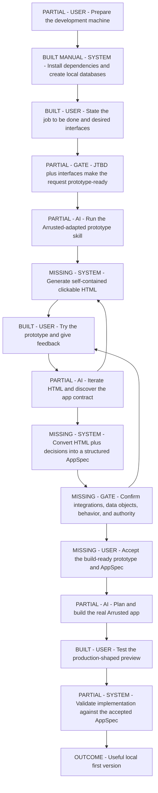
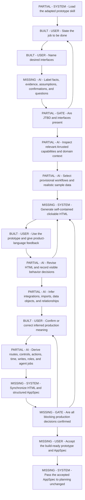
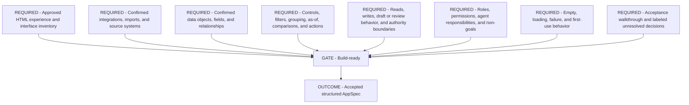
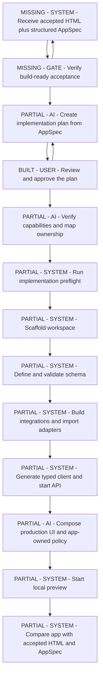
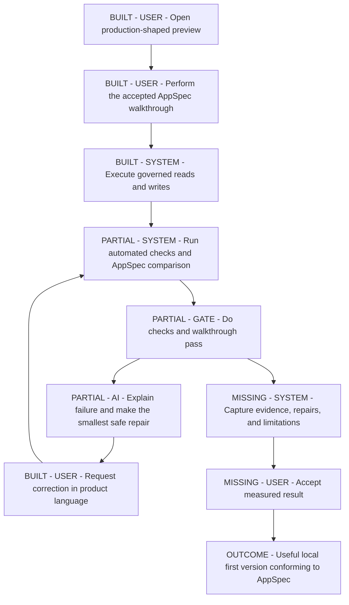

# One-Shot App Figma-Safe Mermaid Copy Pack

These diagrams use a conservative Mermaid subset for reliable Figma and FigJam
import. Actor and readiness are written into each node so meaning survives when
an importer discards colors or shapes. The editable canonical diagrams live
beside this file as `.mmd` sources.

## Reading the boxes

```text
ACTOR
USER = intent, evidence, feedback, confirmation, or approval
AI = research, inference, design, specification, implementation, or repair
SYSTEM = repository tooling, runtime behavior, validation, or stored artifacts

STATUS
BUILT = exists with evidence today
PARTIAL = exists in pieces or requires manual work
MISSING = must be created or adapted
OUTCOME = target result
```

## 1. Journey overview



## 2. Prototype and specification loop



## 3. Build-ready AppSpec gate



## 4. Plan and production build



## 5. Production preview, repair, and proof



## Prototype skill adaptation status

The repository-owned Arrusted skill now adapts the AG2 domain-first reasoning
spine as follows:

1. Move HTML generation immediately after the minimum JTBD plus interfaces gate.
2. Replace the mandatory pre-prototype full interview with labeled assumptions
   and a rapid visual feedback loop.
3. Inspect Arrusted's current docs, component catalog, Storybook, examples, and
   ownership rules instead of AG2 modes, manifests, and multi-verse concepts.
4. Read design tokens from the repository instead of copying literal colors and
   radii into the skill.
5. Generate self-contained HTML for discovery, but do not treat it as production
   code or persisted-data authority.
6. Maintain a structured AppSpec and decision ledger beside the HTML.
7. Require explicit confirmation of integrations and data objects before the
   build-ready gate.
8. Translate the accepted AppSpec into generated clients, app-owned adapters,
   production components, governed writes, and automated proof.
9. Compare the production result with both the accepted HTML experience and its
   structured AppSpec.

The instruction package, question guide, AppSpec contract, repository router,
and acceptance gate are built. Deterministic artifact generation,
synchronization, and production comparison remain automation backlog.
